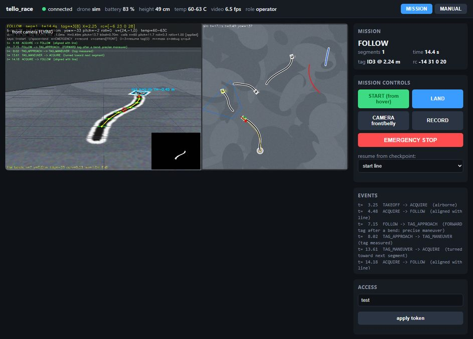
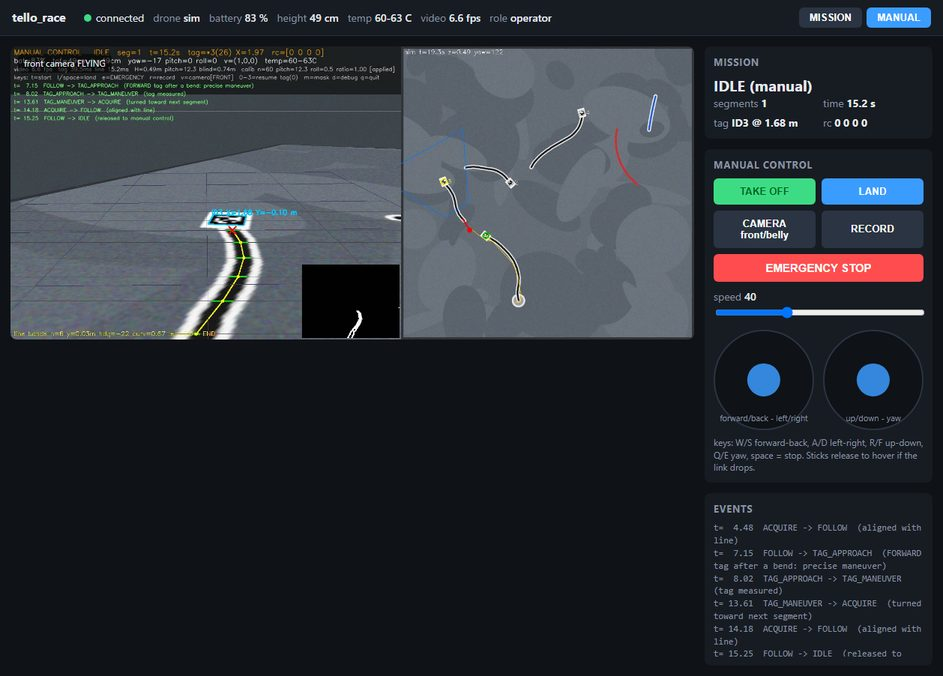
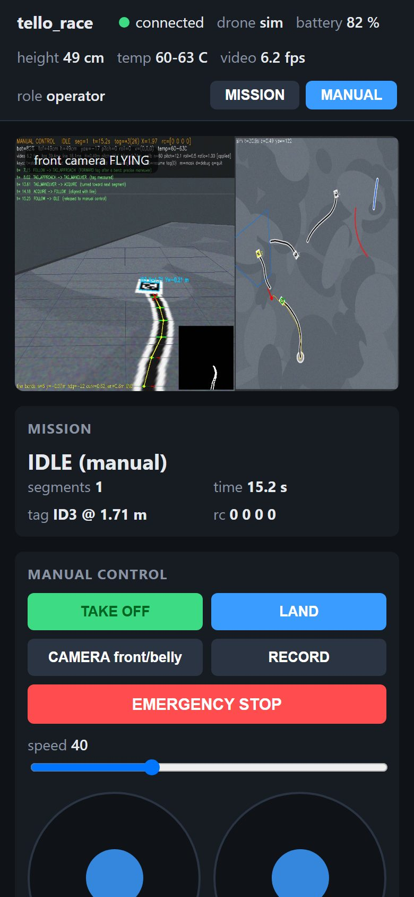
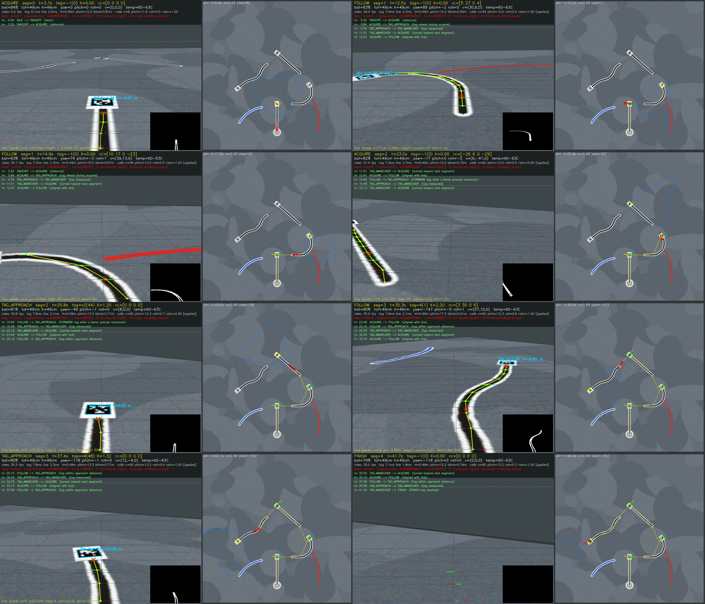

# tello_race - autonomous DJI Tello line + AprilTag racer (MR3003C competition)

C++17 flight software for the *DJI Tello Autonomous Drone Competition* (Tecnológico de Monterrey, MR3003C):
take off on the start marker, follow the dark line on the white strip, read the AprilTag at the end of each
segment (ID 1 forward, 2 left, 3 right, 4 finish), find the next segment 80 cm away, and land on the finish tag,
as fast as reliability allows.

* Real drone, video replay and a physics/vision **simulator** share the same navigator (`tello_race sim`).
* Metric perception: pixels are projected onto the floor using the ToF height and the camera tilt, which is
  **self-calibrated from the floor tags** while flying.
* Safety first: rc watchdog, video watchdog, bounded search patterns, battery gate, checkpoint resume.
* Read [docs/STRATEGY.md](docs/STRATEGY.md) for the rules analysis, architecture and state machine.

## Repository layout

```
CMakeLists.txt, CMakePresets.json   build (MinGW GCC preset for the portable toolchain in C:\dev)
config/default.ini                  every tunable, with comments (copied next to the executable at build time)
src/tello      UDP SDK client (commands, telemetry, rc keep-alive/watchdog), NullDrone for replays
src/vision     FrameSource (low-latency FFmpeg), GroundProjector, LineDetector, TagDetector, Perception
src/control    Navigator state machine + controllers
src/sim        Track generator/renderer and the Simulator (drone kinematics + camera rendering)
src/app        Mission loop (HUD, keys, recording), calibration tools
scripts/       build.ps1, run_sim.ps1, fly.ps1, firewall_allow.ps1, setup_toolchain.ps1
docs/          STRATEGY.md, COURSE_TEC.md (mirror course mode), HANDOFF.md
courses/       simulator courses made from a photo of the real one (tools/course_from_photo.py)
```

## Build (Windows, no admin rights needed)

The project was developed with a portable toolchain in `C:\dev` (winlibs GCC 16, CMake, Ninja, OpenCV 4.14
built with the FFmpeg wrapper). `scripts\setup_toolchain.ps1` recreates it on another PC; then:

```powershell
powershell -ExecutionPolicy Bypass -File scripts\build.ps1
# -> C:\dev\build\tello-race\tello_race.exe   (config/ and all DLLs are copied next to it)
```

Any other toolchain works too: the only dependency is OpenCV (core, imgproc, imgcodecs, videoio with FFmpeg,
highgui, calib3d); the AprilTag library is fetched and built from source by CMake. With Visual Studio:
`cmake --preset msvc-release` after setting `OpenCV_DIR` in `CMakePresets.json`.

## Run

```powershell
# simulator (window + top view). Keys work the same as with the real drone.
C:\dev\build\tello-race\tello_race.exe sim --track example
C:\dev\build\tello-race\tello_race.exe sim --track random --episodes 20 --seed 1 --headless --no-realtime

# real drone: connect the PC to the TELLO-xxxxxx Wi-Fi first
C:\dev\build\tello-race\tello_race.exe telemetry --duration 10      # checks telemetry + video (firewall!)
C:\dev\build\tello-race\tello_race.exe fly --record                 # 't' = take off + start, 'l' = land

# work on recorded videos without the drone
C:\dev\build\tello-race\tello_race.exe replay --source file:logs\run_20260911_120000.avi
```

Keys in the mission window: `t` start, `l`/space land, `e` EMERGENCY motor stop, `r` record, `1-3` resume
from that checkpoint tag on the next start (`0` = start line), `m` mask, `d` debug overlay, `q` quit.

Useful options: `--set section.key=value` (any config value, repeatable), `--dry-run` (video + telemetry, no
flight commands), `--start-at-tag N`, `--dump-every N` (save annotated frames to `logs/frames`).

## The taped course seen through the mirror (course mode)

With the original mirror clip the front camera looks straight down. For that view there is a second navigator
that follows the tape itself from above, flies over the tags in order and never turns:

```powershell
# simulator on the photographed course, then the real drone
tello_race sim --profile config/course_tec.ini --track courses/tec_tarp
tello_race fly --profile config/course_tec.ini --set web.enabled=1
```

The page has a BLUE / YELLOW / BLACK switch for the tape to follow and draws the followed route on the video.
Put the drone on the first tape a hand-span after its beginning, nose along it. Everything else (first flight,
why 1.2 m, simulation results, tuning) is in [docs/COURSE_TEC.md](docs/COURSE_TEC.md).

## First contact with the real drone (verified 2026-09-12)

Tello Talent `TELLO-FE18DB`, no expansion kit mounted, direct Wi-Fi mode: `tello_race telemetry` entered SDK mode on
the first attempt (`sdk=30`), telemetry arrived at 10 Hz and the 960x720 video decoded at ~24 fps (the H.264 warnings
printed during the first second are the decoder waiting for the first keyframe and are harmless). Windows created
inbound allow rules for the program on the Public profile. `scripts\wifi_tello.ps1` joins the drone's network and
`scripts\wifi_tello.ps1 -Back` returns to the home network. Notes from the manual: the aircraft's Micro USB port
is charge-only (1.5 A adapter, aircraft switched off), and a yellow blinking LED means "no client connected" /
"no vision positioning", not an error; it turns purple once the SDK is connected.

## Web interface (ground station in a browser)

`tello_race fly --set web.enabled=1` (or `enabled = 1` in the `[web]` section) serves a single page at
`http://<host>:8080/`: the live camera with the perception overlay (MJPEG), telemetry, mission phase and events,
and buttons for start, land, emergency stop, record and the front/belly camera switch. Commands require the
operator token (`web.token`); a viewer token only watches. It works the same in `sim` mode, which is the way to
try it without the drone: `tello_race sim --headless --set web.enabled=1` then open the page.

From anywhere: on the Pi ground station, `tailscale serve --bg 8080` exposes the page to your tailnet, and
`tailscale funnel --bg 8080` gives a public HTTPS link (Funnel must be enabled once in the Tailscale admin
console). Keep the operator token secret; share the viewer token for spectators. The complete brief for setting
up the Pi ground station (build, Tailscale, VNC, drone Wi-Fi plus internet, Funnel) is `docs/PI_PROMPT.md`;
progress between the two machines is tracked in `docs/HANDOFF.md`.

**Mirror mount and flips.** If a mirror in front of the lens aims the camera down, set `camera.flip` in the config
(`horizontal`, `vertical` or `both`) so the image is un-mirrored before perception; pick the value that makes
printed text readable on the page, then redo `calib-ground` (the auto-calibration accepts pitch up to 85 degrees).
The manual panel has FLIP forward/back/left/right buttons: the Tello performs the flip itself; it refuses below
about 50% battery, and needs about 2 m of clear space all round.

**Outdoors and range.** The drone is the Wi-Fi access point and the Pi's built-in antenna is the weak end of the
link: through walls expect tens of metres at best, in open air 50-100 m. Keep the Pi near a window or take it
outside. The page header shows the drone link in dBm and, in manual flight, the age of the last stick input; if
it turns red with "STICKS RELEASED", your phone or laptop lost contact with the Pi for more than 0.5 s and the
drone hovers until input returns. Wind easily overpowers a 40% stick: raise the speed slider outdoors.

**Mission / manual toggle.** The header has two buttons. MISSION is the autonomous mode (START runs the race
navigator). MANUAL hands the sticks to the browser: TAKE OFF, then keys `W/S` forward/back, `A/D` left/right,
`R/F` up/down, `Q/E` yaw, space = stop, or drag the two on-screen pads on a phone; the speed slider scales the
sticks. The browser sends the stick values 10 times per second and the ground station zeroes them (hover) if no
update arrives for 0.5 s, so a dropped connection never leaves the drone drifting. Switching to MISSION while
airborne stops the sticks; START then runs the mission from the current hover. Switching to MANUAL during a run
releases the navigator immediately (the drone hovers). LAND and EMERGENCY work in both modes; only the operator
token can change modes or move the drone, a viewer only watches. START, TAKE OFF and EMERGENCY STOP ask for a
second click within 3 s (the button turns yellow) instead of a browser dialog, so they also work inside embedded
browsers. If a button does nothing, read the yellow message at the bottom of the page: it says whether the page
is not connected or the token only watches. The header must read "connected" and "role operator" before the
MISSION/MANUAL buttons do anything. Manual flight over a Funnel link adds internet
latency (typically 100-300 ms) on top of the video delay, so keep the speed slider low when flying remotely.
A link of the form `https://<host>/?token=<viewer token>` stores the token in the browser once, so spectators
only need the link.

| Mission mode (desktop) | Manual mode (desktop) | Manual mode (phone) |
|---|---|---|
|  |  |  |

## Before the competition: calibration checklist (practice track)

1. **Connectivity**: `tello_race telemetry --duration 10`. Both "telemetry: OK" and a video fps > 20 are required.
   If either is missing, allow the program through Windows Firewall (`scripts\firewall_allow.ps1` from an
   elevated PowerShell, or click "Allow" in the firewall pop-up) and make sure the PC is on the drone's Wi-Fi.
2. **Line colour**: `tello_race calib-color` (drone on the floor or held over the track). Click the line in several
   places (near and far), press `w` and click the white strip, then `s` to save. Black tape gives `color_mode = dark`.
3. **Tag family and size**: check the printed tags with `tello_race calib-ground` (the detector must show `ID n`).
   Measure the black square edge with a ruler and set `tag.size_m`; the tool also prints the size implied by the
   ToF height (press `z` to save it).
4. **Camera tilt**: in the same tool, hover the drone 1-2 m in front of a floor tag and press `s` when
   `samples` > 20; this stores `camera.pitch_deg`/`camera.roll_deg`. It is also refined automatically in flight.
5. **SDK sign conventions** (once per drone): after a `fly --dry-run` check that telemetry `pitch` is positive
   nose-up while you tilt the drone by hand (`ground.imu_pitch_sign`), and verify with a manual `go 0 50 0 30`
   from the Tello app or a script that +y moves LEFT (`tello.go_y_left`). Then, in MANUAL mode, push the right
   stick slowly forward and then left while watching `vgx`/`vgy` in the page header: the navigator dead-reckons
   the last tag with them. Set `tello.vel_scale` so that the values match m/s (the SDK prints cm/s: 0.01) and
   `tello.vgy_sign` so that moving LEFT gives a positive `vgy` times the sign (defaults match the simulator).
6. **Speeds**: fly the practice track with the defaults, then raise `follow.v_max` until runs start to fail,
   and back off one step. Record everything (`--record`) and replay to inspect.

## Race day with the Raspberry Pi ground station

Everything runs on the Pi from power-on. The laptop only shares its internet over the Ethernet cable
(Windows Internet Connection Sharing, laptop = 192.168.137.1, Pi = 192.168.137.10) and must stay awake.

1. Pi powered and wired to the laptop; laptop on Wi-Fi with the sharing on. Nothing is started by hand.
2. Power the drone on and wait about 45 s. The `drone-watch` service on the Pi sees `TELLO-FE18DB`, joins it
   (the Pi keeps its internet through the cable) and starts `tello_race fly` with the web page.
3. Open `https://quiquepi.tail2b1864.ts.net/?token=<operator token>` from any browser on any network; spectators
   use `?token=watch`. The header must read "connected". A 502 means the ground station is still starting: reload.
4. MANUAL for a hand-flown check (TAKE OFF needs two clicks), MISSION plus START for the autonomous run. Power the
   drone off after each run; about 20 s later the Pi stops the ground station and waits for the next power-on, so
   a battery swap is the same procedure.

Watching the Pi: `ssh quiquepi@100.112.7.35`, then `journalctl -t drone-watch -f`, or `tmux attach -t claude`
and its `drone` window. Manual override: `systemctl --user stop drone-watch`, then `scripts/pi/drone_wifi.sh up`
and `scripts/pi/ground_station.sh start`. After a reboot `scripts/pi/boot_check.sh` verifies address, route,
Tailscale, Funnel and services. Perception on real 960x720 frames runs at about 28 fps on the Pi 5.

## Competition day

* Battery > 60 % on every attempt; the software refuses to take off under 25 %.
* Judge places the drone on the start marker facing the line, you press `t`.
* If an attempt is stopped, place the drone on the last tag reached and press the tag number (`1`, `2` or `3`)
  then `t`: the drone takes off, performs that tag's turn and continues (20 s penalty, but the segments count).
* `l` or space lands at any time; `e` cuts the motors (only if a crash is imminent).

## What the simulation looks like



Left half of each tile: the simulated Tello camera with the perception overlay (line chain in yellow/magenta, tag
box, pursuit point, HUD with phase, telemetry, timers and the last state transitions; the small black panel is the
line mask). Right half: top view of the track with the drone, its camera footprint (blue) and its trail (yellow).
`--dump-every N` writes these annotated frames for any run; `--record` stores the raw camera video and a CSV of
telemetry and commands, which `tello_race replay` can process again offline.

## Simulation results

`tello_race sim --track random --episodes N --headless --no-realtime` prints one line per course and a summary.
The simulator renders the camera view from a textured track with tags, lines of other colours, video latency,
sensor noise and imperfect `go`/turn execution, so it exercises exactly the same navigator code that flies the
real drone. Latest validation with the default configuration (see docs/STRATEGY.md section 7 for the history):

| Run | Result |
|---|---|
| Example course from the slides | 4/4 segments, 46.8 s |
| 30 random rule-compliant courses (seeds 300-329) | 29/30 completed, mean 49.8 s (the failure took the FINISH tag one segment early) |
| 30 random rule-compliant courses (seeds 400-429) | 29/30 completed, mean 50.6 s (the failure: first segment only 1 m long and bending at once, invisible from the start position) |
