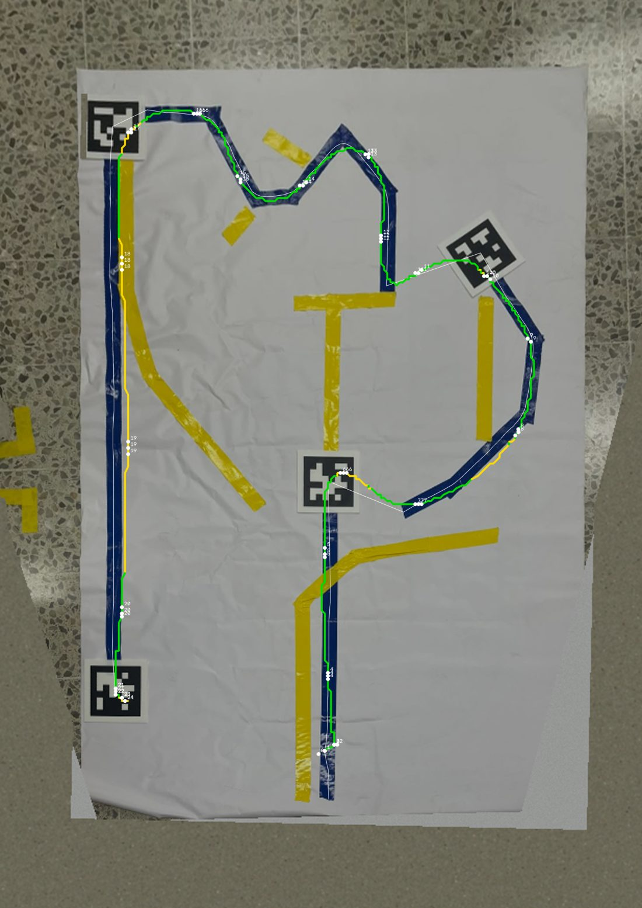

# Course mode: the taped course seen through the mirror

Profile `config/course_tec.ini`: white tarp, blue path, yellow decoy tapes, tags 1 → 2 → 3 → 4, flown with the
**original mirror clip** (`Tello_Mirror_Clip_2.STL`, 45° seat).



*A simulated flight over the photographed course. Green: less than 3 cm from the tape centre, yellow: less than
6 cm. White dots: one per second.*

## What it does

With that clip the front camera looks straight down, a little backwards (96-99° measured; 90° is straight
down). From 1.2 m it sees a patch of floor about 1.25 m wide and 0.95 m long with the drone above its front third:

| mirror angle | floor seen ahead | behind | to each side |
|---|---|---|---|
| 96° | 0.33 m | 0.62 m | 0.63 m |
| 97° | 0.31 m | 0.65 m | 0.63 m |
| 99° | 0.26 m | 0.70 m | 0.63 m |

The line-ahead-of-the-nose navigator has nothing to work with in that view, so this profile switches to a second
one (`nav.mode = course`):

* every piece of tape of the chosen colour in the picture becomes a centre-line on the floor, in metres;
* the drone follows the tape it is on, slows down for corners, flies over the tag at its end, crosses to the
  nearest other tape end (the start of the next segment) and goes on, in the order `course.tag_order`;
* it lands on the last tag;
* the nose either stays where it pointed at take-off, the drone moving forwards, sideways and backwards
  (`course.heading = fixed`), or turns to point along the route (`course.heading = path`). The path following
  underneath is the same; the page switches between the two.

The turn meaning of the tags (ID1 forward, ID2 left, ID3 right) is **not** used: on this course it does not match
the layout (after ID3 the path leaves about 100° to the left). The rule is "follow the chosen colour, visit the
tags in order".

## Running it

```
# simulator, on the photographed course (add --set web.enabled=1 to watch it in the browser, /sim3d for 3D)
tello_race sim --profile config/course_tec.ini --track courses/tec_tarp

# real drone
tello_race fly --profile config/course_tec.ini --set web.enabled=1
```

On the ground-station page the panel **Path to follow** has three buttons, BLUE / YELLOW / BLACK. The video shows
which one is active ("FOLLOW BLUE") and draws the route the drone is following in that colour, with a green cross
on the next tag or line start. Under them, **NOSE FIXED / NOSE FOLLOWS PATH** chooses whether the drone keeps its
take-off heading or turns with the route (the video label says `NOSE: FIXED` or `NOSE: PATH`). Both can be changed
on the ground or in MANUAL, not while the mission flies. Keys in the desktop window: `b`, `y`, `k`, and `n` for the nose.

## Placing the drone

On the first tape, **about a hand-span (15 cm) after its beginning, nose along the tape**. The camera looks down
and backwards, so it needs some tape behind the drone to start from. ±15° of heading is fine; turned by 90° or
180° it is not (the camera would be blind in the direction of travel).

## First flight with a newly mounted mirror

The exact angle of the mirror is not known until tags have been seen. So on the first flight:

1. the first segment is flown with the configured guess (`camera.pitch_deg = 96`): the drone may run up to
   10 cm beside the tape there;
2. at tag 1 it stops and moves a hand-span around the tag for about 5 s ("measuring the camera angle over the
   tag"). The tag is seen all over the picture, which gives the mirror angle to a few tenths of a degree and
   shows which way the telemetry counts pitch and roll;
3. from there on the flight is the normal one.

After landing, what was measured (mirror angle, lean signs, stick gain) is written to
`config/learned_course_tec.ini` and loaded at the next start: later flights skip step 2 and are exact from the
first metre. **Delete that file after re-seating the clip or changing the drone.** If the mirror has moved a few
degrees since, the flight still works: the angle keeps being refined from every tag.

The same measurement can be made without flying: hold the drone level about a metre above a tag and move it
slowly so the tag crosses the whole picture a few times. The page video shows `calib ... [applied]` and the file
is written within seconds.

If the measured angle is outside 84-104° the mission lands on tag 1 and says so: beyond that the camera sees
almost nothing ahead of (or behind) the drone. Re-seat the clip.

Before pressing START the first time, on the page:

* the floor **ahead** of the drone is at the **top** of the video (`camera.flip = vertical`). If the image is the
  other way up the drone would fly against its commands; the navigator notices that within a second and lands
  ("image reversed: check camera.flip"), but it is cheaper to look first;
* the small black-and-white inset shows the blue tape as clean white strokes, and thin white lines run along the
  tape in the video. If the tape is missing there, the colour limits in `[line]` need adjusting to the real
  camera (`blue_lo`, `blue_hi`; hue 0-180);
* battery above 25 % (below that the mission refuses to take off).

## Why 1.2 m

Altitude sweep in the simulator (mirror angle known, 10 flights each):

| altitude | course time | path error (mean) | distance to the tag centres |
|---|---|---|---|
| 0.9 m | 26.1 s | 1.9 cm | 2.7 cm |
| 1.0 m | 25.6 s | 2.0 cm | 2.6 cm |
| **1.2 m** | **24.5 s** | 2.0 cm | 2.7 cm |
| 1.5 m | 25.2 s | 1.8 cm | 3.1 cm |
| 1.8 m | 26.2 s | 1.9 cm | 3.4 cm |

* Accuracy is flat: what limits it is not the picture. (In this batch the stick gain was still the guess, so the
  times are 2 s shorter than the later-flight figure below; the comparison between heights holds.)
* Lower is shorter (less climbing after take-off, shorter landing) until the view gets too small: below about
  1 m the start of the next tape (12-32 cm beside each tag) is close to the edge of the picture, and the drone
  has to slow down because it sees too little tape ahead.
* Every degree of error in the mirror angle or in the lean of the drone moves the floor by 2.1 cm at 1.2 m,
  2.6 cm at 1.5 m.
* At 1.2 m a tag is 123 pixels across and the tape 38: plenty.

So 1.2 m, and the last 60 cm before the finish tag are flown coming down to 0.85 m (`course.finish_altitude_cm`),
which shortens the landing.

## What the simulator says

The simulator flies the photographed course itself (the photo is rectified with the four tags and used as the
floor), with motion blur, 130 ms of video latency, telemetry at 10 Hz in whole degrees, a drone that leans when it
accelerates, a start position off by 5 cm and 5°, an unknown stick gain (configured 0.015, real 0.020 m/s per
unit) and a random drift of up to 8 cm/s.

| | finished | course time | path error mean / worst moment | tag centres |
|---|---|---|---|---|
| first flight (mirror guessed 96°, really 97°; stick gain guessed) | 20 / 20 | 29.8 s | 2.1 cm / 7.7 cm | 2.4 cm |
| later flights (mirror, lean signs and stick gain learned) | 20 / 20 | 26.5 s | 1.8 cm / 6.1 cm | 3.0 cm |
| ... without the drift | 20 / 20 | 26.0 s | 1.2 cm / 4.7 cm | 2.6 cm |

Course time is take-off to landed; about 3 s of it are the take-off and 3.5 s the landing, and on the first flight
5 s are the measurement at tag 1. The route is 5.95 m. (The first flight flies faster than intended until the stick
gain has been measured: the guess is 25 % low on purpose, the careful side.)

Things that were varied one at a time and still finished every time. Twenty first flights each: mirror really at
92° or at 102°; telemetry pitch and roll signs both wrong; drone answering the sticks in 0.7 s instead of 0.35;
video latency 300 ms; picture 40 % darker. Six to ten flights each: mirror roll -3° / +4°; stick gain 0.010 and
0.030; sideways gain different from forward; sticks dead below 4 or 8 units; height sensor reading 7 % low or
high; focal length 5 % off; telemetry at 5 Hz; twice the image noise; 1/25 s exposure; picture 20 % brighter;
drift doubled; start 12 cm and 15° off; mirror moved to 101° after having been learned at 97°. A slow drone or a
long latency costs accuracy (4-5 cm mean instead of 2), not the course.

Where it stops working: mirror beyond about 103° (the mission lands on tag 1 with a message), a picture less than
half as bright as the photo, the drone put down facing sideways or backwards.

## Speed against precision

| preset | settings | course time | path error (mean) |
|---|---|---|---|
| careful | `lat_accel_ms2 = 0.5`, `accel_ms2 = 0.7`, `v_cruise_ms = 0.45` | 28.7 s | 1.7 cm |
| **profile** | 0.8 / 0.9 / 0.60 | 26.5 s | 1.8 cm |
| fast (`config/course_tec_fast.ini`) | 1.2 / 1.2 / 0.80, `v_gap_ms = 0.35`, `response_tau_s = 0.35` | 23.1 s | 2.1 cm |
| faster | 1.8 / 1.5 / 1.0, `v_gap_ms = 0.45`, `response_tau_s = 0.35` | 21.9 s | 2.2 cm |

(Later flights, everything learned, 20 flights each.) The fast one is ready as a second profile:
`--profile config/course_tec.ini --profile config/course_tec_fast.ini`.

All in `[course]`:

* `lat_accel_ms2` sets the speed in corners (higher = faster and rounder). This is the main knob: the zigzag
  before tag 3 is where the time goes.
* `v_cruise_ms` only matters on the two long straights.
* `response_tau_s` is how quickly the navigator believes the drone answers the sticks. 0.5 is the careful guess
  for a drone nobody has measured; if the real one turns out snappy, 0.35 gains 1 s. The other way round is
  worse: 0.35 assumed with a drone that takes 0.7 s lost the course in 3 flights of 6.
* `k_cross` / `k_bias` pull the drone back onto the tape and hold it against a steady drift.
* `finish_altitude_cm = 0` lands from the cruise height instead.

Fly the fast presets only after the profile has flown well on the real drone: the simulator's drone is a model.

## What the vision costs, and the battery

The vision runs on the ground station (the Pi), not on the drone. The drone's battery goes into the motors; what
the ground station computes does not change how long it flies. What does: the flight being short (26.5 s instead
of the 45-50 s of the turn-and-go navigator on a course of this size), and not leaving the drone switched on,
streaming, on the ground (it also overheats there).

For the ground station itself, the vision per camera frame, measured on the laptop with nothing else running.
The absolute times swing by a factor of four with the laptop's power state, so two sittings are shown; the
proportion is what holds:

| | sitting A | sitting B |
|---|---|---|
| whole frame searched for tags, every frame, tape at 640 px | 7.5 ms | 37.9 ms |
| tags searched in small windows, every frame | 4.0 ms | 15.3 ms |
| ... and only every other frame | 2.8 ms | 11.3 ms |
| ... and the tape at 480 px (the profile) | | 7.4 ms |

About a fifth of what it was. The speckled floor around the tarp is what made the tag search expensive
(thousands of little shapes to reject): the search now runs only around tags already followed and around dark
squares of the right size, and over the whole frame once a second as a safety net (`tag.windows`,
`tag.full_frame_every_s`). The tape is traced at half the camera width (`line.proc_width = 480`): half the cost,
same tracking in the simulator (10/10 flights, 2.1 cm).

On the Pi 5 itself (headless simulator, 2026-10-12): **4.2 ms per frame** with the profile (tags 1.6 ms, tape
2.5 ms) against 19.5 ms the old way (tags 14.0 ms, tape 5.4 ms). Flying the simulated course in real time and
serving the page to a browser, the Pi kept 26 frames a second. To repeat it, no drone needed:

```
./build/tello_race sim --headless --no-realtime --profile config/course_tec.ini --track courses/tec_tarp --episodes 1 --seed 1 | grep "vision cost"
```

While nothing is flying the ground station now processes 10 pictures a second instead of 30
(`mission.idle_fps`).

`tello.video_fps`, `tello.video_bitrate` and `tello.video_resolution` pass the SDK 3.0 video settings to the
drone (empty = untouched, the default). A lower bitrate is a little less work and heat for the drone. They have
not been tried on the real drone; keep the resolution `high` (the vision expects 960x720).

## What makes it land early (on purpose)

* the drone moves against its commands for more than half a second: the image is upside down (`camera.flip`);
* mirror angle outside 84-104° once measured;
* no tape of the chosen colour within 1.2 m after take-off (after creeping forward 40 cm);
* the path lost for 5 s; no next tape found near a tag after rising twice by 30 cm;
* more than `course.max_range_m` (3.5 m) from where it took off;
* battery under 25 % at the start; LAND or EMERGENCY from the page at any time.

## The two nose modes

| | fixed | follows the path |
|---|---|---|
| simulator, later flights, mirror at 93° as measured (20 each) | 20 / 20, 25.5 s, 1.8 cm | 20 / 20, 27.0 s, 2.2 cm |
| simulator, first flight (20 each) | 20 / 20, 29.6 s | 20 / 20, 32.9 s |

With the nose fixed the camera's long side (it sees further behind than ahead) looks along whatever direction the
drone happens to travel in; with the nose on the path the short side always looks ahead, so every tag comes into
view late and is approached slowly, and at a tag the drone may turn on the spot to find the next tape. That is
where the 1.5 s go. `course.heading_look_m` (how far ahead the nose aims) and `course.max_yaw_rc` (how fast it
turns) shape how it looks.

`course.camera_ahead_m = 0.06`: the mirror looks down from 6 cm ahead of the drone's centre. It is the centre that
is kept on the tape and over the tags, in both modes.

## The first real flights (2026-10-12)

Five missions with the nose fixed, from the page. The fifth flew the whole course, tags 1-2-3-4 and a landing on
tag 4, in 28.7 s. What the Pi's log showed about the other four, and what was changed:

* two were ended by the range limit ("3.5 m from the take-off point") while inside the course: the dead reckoning
  it relies on over-reads by half when the stick gain is still the guess. Limit now 6 m;
* after a tag the next tape was sometimes taken to be the far end of a piece of the tape just flown (the real tape
  breaks into pieces under glare and where the yellow one crosses it). A tape now qualifies only if it runs away
  from the tag;
* while waiting over a tag for the next tape to come into sight, the drone held a remembered point and drifted off
  it. It now holds on the tag it sees;
* the mirror measurement at tag 1 ran again on a later flight. Once per run now;
* the drone flew with the point under the camera on the tape, not its own centre (6 cm behind). See above.

Measured on the real drone: mirror 92.5-94.3° pitch, 1-2.4° roll (the fit moves about 1° from flight to flight);
telemetry pitch and roll both count the lean the way the model assumes; stick gain 0.010-0.015 m/s per unit; blue
tape, tags and the white tarp are seen as in the simulator; 23-24 frames a second on the Pi in flight. The drone's
board went from 42 to 77 °C over those ten minutes: switch it off between flights.

## Not verified on the real drone yet

* the nose-follows-path mode has only flown in the simulator;
* the fixes above have only flown in the simulator;
* how quickly the real drone answers the sticks (`course.response_tau_s = 0.5` is still the careful guess).

## Another course from another photo

```
uv run tools/course_from_photo.py photo.jpg courses/<name> [--tag-size 0.16] [--order 1,2,3,4]
tello_race sim --profile config/course_tec.ini --track courses/<name>
```

The photo must show all the tags; they give the scale and the perspective. The tool writes the floor image, the
course description (`course.txt`) and `debug.png`, which shows what it understood: check it. The simulated drone
starts 15 cm along the first segment (`--start-in`).
