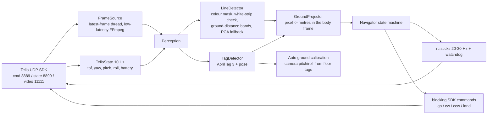
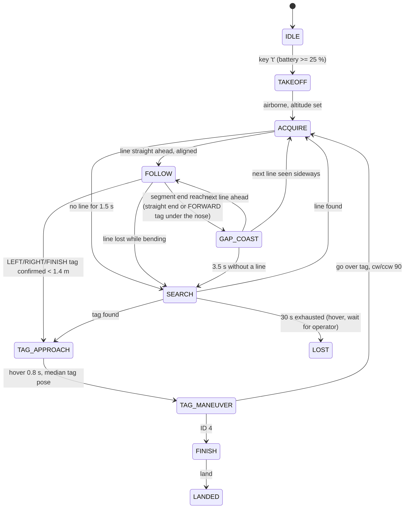

# Winning strategy for the MR3003C Tello autonomous race

## 1. What the rules reward

| Rule (from the PDFs) | Consequence for the design |
|---|---|
| Ranking = **number of completed segments**, then total time | Reliability dominates. A drone that finishes all 4 segments slowly beats a fast one that fails on segment 3. Speed is optimised only after every segment completes consistently. |
| Touching the net invalidates the attempt; crash = lost turn | The drone must never fly blind. Every state has a time bound; when the line is lost it stops, then searches with small bounded motions (back / yaw sweep / rise). |
| Resume from the last checkpoint costs 20 s; idle 1 min = error | A resume mode exists (`--start-at-tag N` / keys 1-3) but the goal is to never need it. The search phase gives up into a hover instead of drifting. |
| Following a line of another colour costs 10 s | The line model is colour-calibrated per track and, by default, requires the dark line to sit on the 10 cm white strip (rejects coloured tape, carpet patterns, shadows). |
| Tags on the floor: ID1 forward, ID2 left, ID3 right, ID4 finish; next segment starts **80 cm** from the tag | The maneuver is geometric: measure the tag position from its AprilTag pose, fly exactly over it with the VPS-based `go`, rotate 90 degrees, look for the line 80 cm ahead. |
| Layout is random and the code is frozen once known | Nothing is layout-specific. Direction tags are handled generically, each ID is expected once and is ignored after it is passed. |
| Altitude is free | Default cruise height is 50 cm. Lower reduces the blind zone in front of the forward camera; the height is a single config value. |
| Battery: running out = lost turn; 13 min per battery | Preflight battery gate (25 %), warning in the HUD, and an offline simulator so battery time is spent validating, not developing. |

## 2. Architecture

Everything in the navigator works in **metres in the drone body frame** (X forward, Y left). Pixels are converted with a pinhole model plus the known camera height (ToF sensor) and tilt; the airframe pitch/roll from telemetry is included so the mapping stays valid while the drone leans into its motion. The same navigator drives the real drone, a video replay and the simulator.

## 3. Perception

* **Line mask**: HSV threshold (`dark` mode for black tape, explicit `hsv` ranges for coloured tape) → optional AND with the dilated white-strip mask → morphology → everything above the horizon cleared → AprilTag quads removed.
* **Band scan**: scan lines are placed at fixed *ground* distances ahead (every 15 cm from the blind zone to 3 m). In each band the mask runs are projected to the floor; a run is a line candidate only if its projected width is 1-8 cm (tag borders and large dark objects are rejected). The chain follows the run closest to the extrapolated position of the previous band, so curves are tracked and neighbouring lines are ignored. Two empty bands after the chain end mean *the segment ends here* (`endVisible`).
* **Component fallback**: if the band scan fails (e.g. the next segment starts sideways after a turn), the largest plausible connected component gives an axis and endpoints via PCA, ordered from the expected start point (80 cm ahead).
* **AprilTags**: `tag36h11` (configurable), full-resolution grey image, `quad_decimate` 1.5, decision-margin threshold, hamming 0 only, IDs limited to 1-4, temporal confirmation over 2 frames, one-shot per ID.
* **Tag pose → ground model**: a tag lying flat on the floor gives the camera tilt, roll and height. The median over recent detections refines `camera.pitch_deg` on the fly (verified in simulation: configured 10°, true 12°, recovered 12.1°). The height implied by the tag is compared with the ToF height, which validates the configured tag size.

## 4. Navigation state machine

### FOLLOW controller (pure pursuit on the projected line)

* Target = point on the line polyline 45 cm beyond its nearest visible point (shorter in bends).
* Yaw stick = `-k_yaw * bearing(target)` with a derivative term; lateral stick = `-k_lat * lateral offset` of the nearest point; both slew-rate limited so the video stays smooth.
* Forward stick = `v_min + (v_max - v_min) * f(bearing) * g(curvature)`, reduced further near a visible segment end or a tag; if the bearing exceeds 25 degrees the drone turns in place first.
* Altitude hold on the ToF height with a deadband (vertical stick).
* Every stick update goes through a keep-alive thread with a watchdog: if the vision loop stalls for 0.5 s the sticks are zeroed and the drone hovers.

### Tag maneuver (LEFT / RIGHT / FINISH)

1. The tag is confirmed in 2 consecutive frames while its ground distance is below 1.4 m (still well inside the image).
2. Hover; after 0.8 s take the median of the settled pose samples (X forward, Y left in metres).
3. `go X Y 0 60` puts the drone over the tag using the Tello's own visual-positioning odometry (accurate to a few cm over 1.5 m).
4. `cw 90` / `ccw 90` (or a closed-loop yaw on telemetry with `tag.turn_mode = rc`), then ACQUIRE expects the next line 80 cm ahead. If the blind zone is longer than 80 cm the first search action is to step back so the segment start enters the view.
5. FINISH: `go` over the tag and `land` immediately (the clock stops at landing).

FORWARD tags cost no time: the drone keeps following, the tag passes under the nose, and it coasts straight (steering to keep the tag centred while visible) until the next line appears.

## 5. Failure modes and mitigations

| Failure | Mitigation in the code |
|---|---|
| Sharp bend leaves the camera view | Chain-end test checks for line pixels bending away; FOLLOW turns in place above 25 degrees; SEARCH sweeps first toward the side the line went, without stepping back. |
| Line lost for good | Coast 0.4 s, hover to 1 s, then bounded SEARCH (back 30 cm, yaw sweep widening from 40 to 100 degrees, rise 25 cm), then hold position. The drone never drifts toward the net. |
| Another coloured line / carpet pattern / shadow | Colour calibration + white-strip requirement + plausible-width test (1-8 cm on the ground, orientation independent). |
| AprilTag black border looks like a line | Detected quads are erased from the line mask; width test rejects the border anyway. |
| Video freezes | Mission loop lands after 2.5 s without frames; rc watchdog hovers after 0.5 s without fresh sticks. |
| Telemetry missing (firewall) | Ground model falls back to the configured altitude; the HUD warns. `tello_race telemetry` verifies both UDP ports before flying. |
| Wrong `go` lateral sign, IMU sign | Both are single config switches (`tello.go_y_left`, `ground.imu_pitch_sign`); verify once on the practice track. |
| Low battery | Takeoff refused below `mission.min_battery`; HUD turns red under 30 %. |
| Crash / net contact during an attempt | Checkpoint resume: put the drone on the last tag and start with `--start-at-tag N` (or keys 1-3): it takes off, turns, and acquires the next segment. |

## 6. Speed plan for competition day

1. Fly the practice track at the default speeds until every run completes (reliability first).
2. Raise `follow.v_max` in steps of 10 while runs still complete; keep `follow.v_min` and the bend logic unchanged.
3. Optionally switch `tag.turn_mode = rc` and raise `tag.go_speed` to 80 for faster maneuvers once the telemetry yaw is confirmed reliable.
4. Record every run (`--record`); replay the videos with `tello_race replay --source file:logs/run_x.avi` to tune vision without spending battery.

## 7. Simulation results

The simulator (`tello_race sim`) renders the forward camera view of a textured carpet with the white strip,
the dark line, the four AprilTags on letter-size paper and two lines of other colours, with 3 frames of
video latency, sensor noise, motion blur, hover drift, imperfect `go`/turn execution and a camera tilt that
differs from the configured one (auto-calibration has to recover it). Random tracks follow the rules: four
separate segments with arbitrary bends, tags at their ends, the next segment starting 80 cm from the tag,
with a random order of FORWARD/LEFT/RIGHT and up to +/-85 degrees of initial deviation of the next segment.

Batch runs (`--track random --episodes 30 --headless --no-realtime`, default configuration):

| Build | Courses completed | Mean time (completed) | Typical failure |
|---|---|---|---|
| first navigator | 7 / 10 | 37 s | corner cut on bends, coasting straight after a FORWARD tag, tags of other segments |
| + line-end direction, strict tag association | 25 / 30 | 39 s | previous segment retraced backwards after a failed acquire |
| + precise FORWARD maneuver, step back after turns, post-command video blind period, start gating | 29 / 30 | 52 s | chord rule noise when the chain end is very close to the tag |
| + distance-blended end direction (current) | see README | | |

The example course from the competition slides completes in 42-47 s depending on the build. Per-tag cost of
the precise maneuver (stop, measure, `go`, turn, step back, acquire) is about 6 s; `tag.forward_fast_path = true`
skips it for FORWARD tags when the practice track shows the fast coast is safe.

Things the simulator does not capture and must be checked on the real drone: the actual stick-to-speed
mapping (`follow.v_max` is a stick value), the real video latency, the Tello's `go` accuracy on the actual
floor texture, ToF height noise, lighting (shadows, reflections on the white strip) and the exact colour of
the tape. All of these are exposed as configuration values and calibration tools (see README).
